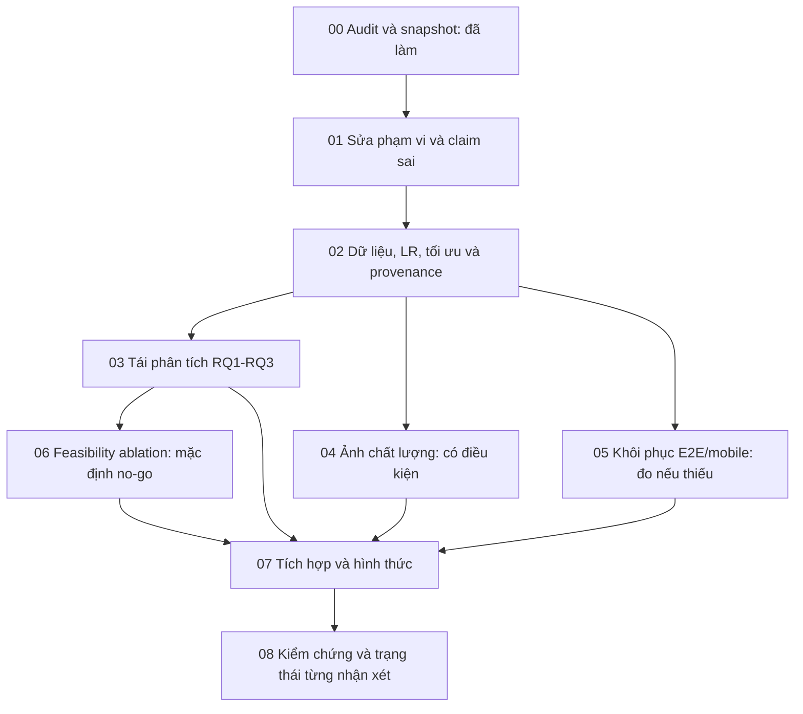

# Roadmap và hợp đồng bàn giao

## Sơ đồ phụ thuộc

Mũi tên từ phase có điều kiện chấp nhận **output có số thật** hoặc **disposition NOT_RUN/NO_GO/SKIP_RERUN có lý do**; không được coi bỏ qua là thí nghiệm đã hoàn tất. C5 thiếu định lượng vẫn PARTIAL/OPEN. A3 `DEFERRED_BY_USER` không chặn đường găng. A1 thiếu nguồn cấp bài phải thể hiện OPEN ở hồ sơ cuối, không tự điền.

## Bảng điều phối và quyền sở hữu tệp

| Phase | Phức tạp | Nhận xét chính | Sửa/tạo chính | Không thuộc phase |
|---|---|---|---|---|
| 00 | Vừa, đã thực hiện | A1–D3 | docs/revision-plan; audit evidence | Không sửa report/app/train/build |
| 01 | Thấp–vừa | B1/B3/B4/C3/C7/D1–3 | scope, đoạn integration sai, intro/architecture/conclusion; outputs/phase-01 | Không đổi adapter/contract, không model mới |
| 02 | Vừa | B2/C1/C2/C3/C7/C6 | data card/LR/compression metadata; phương pháp tương ứng; outputs/phase-02 | Không tune/test selection/train |
| 03 | Vừa | C4 | RQ sections, independent analysis scripts/CSV; outputs/phase-03 | Không sửa formulas/rescue_core hoặc artifacts cũ |
| 04 | Vừa, conditional | C5/C2/C6 | Harness/gói corruptions và output riêng; chỉ bổ sung subsection riêng | Không đổi default inference/model hay nguyên ảnh |
| 05 | Vừa, conditional | C6/B2/C3 | Recovery register, validation raw, targeted runs; subsection system tests | Không reset DB/port graph/đổi E_i behavior |
| 06 | Thấp feasibility; nghiên cứu thật cao | B5/B3/B4 | Eligibility/no-go/protocol trong outputs/phase-06 | Không train NLP hoặc tạo kết quả ablation khi thiếu common gold |
| 07 | Vừa | A1/A2/A4/A5, tổng hợp B–D; A3 hoãn | Kết luận/tóm tắt/figures/tables/template nếu cần; source docs drift | Không phát minh số, không thực nghiệm mới |
| 08 | Vừa | A1–D3 | Validation records, traceability, response draft nội bộ | Không tự khắc phục thuật toán/đổi kết quả để pass |

Không giao hai Agent sửa cùng source đồng thời. Nếu chạy 04/05 riêng, mỗi phase viết output/subsection có ranh giới; P07 tích hợp. P01 chỉ sửa mệnh đề sai về E_i/phạm vi; P02 mở rộng giải thích kỹ thuật; P03 chỉ sửa nhóm RQ; P07 không tính lại nghiên cứu. Như vậy giảm việc viết lại cùng chương mà vẫn sửa claim Critical sớm.

## Chi tiết từng phase

### Phase 00 — Audit và kế hoạch

- **Mục tiêu:** xác định evidence, gap, nguồn thuyết minh và trạng thái riêng Implemented/Executed/Evaluated/Reported.
- **Nhận xét/phạm vi:** toàn bộ A1–D3; chỉ đọc repo/history/ref và tạo kế hoạch.
- **Đầu vào:** yêu cầu nguyên byte, amendment A3, DOCX/PDF, source/artifact/nhánh hiện có.
- **Bước:** snapshot dirty tree → kiểm sources/refs/notebooks → kiểm hashes/data/raw → map report → ma trận/gaps/roadmap/prompts → kiểm link/coverage/preservation.
- **Đầu ra:** bảy tài liệu chính, chín prompt và evidence trong thư mục này.
- **Phụ thuộc:** không; đây là phase đã thực hiện trong lần hiện tại.
- **Tiêu chí:** đủ 20 ID, chín prompt tự chứa; missing có giới hạn tìm; không thay tệp gốc.
- **Kiểm chứng:** collector, source hashes, raw phone metrics, float checker, kiểm bảo toàn và tài liệu.
- **Rủi ro:** tài liệu lịch sử cũ, raw ngoài máy, nguồn web biến động.
- **Chuyển phase:** người dùng dùng prompt01; không ngầm kích hoạt P01 ngay sau audit. Refresh00 chỉ khi drift nguồn.

### Phase 01 — Sửa claim và phạm vi, thêm Future Work ngay

- **Mục tiêu:** báo cáo phản ánh đúng mức hoàn thành và luồng runtime, trước khi thêm số mới.
- **Nhận xét:** B1/B3/B4/C3/C7, D1/D2/D3; kết luận C4 chỉ dùng số đã có, không tự suy luận mới.
- **Đầu vào:** audit E01/E03/E04/E15–17, request+amendment; nguồn report/source code hiện tại.
- **Bước:** xác nhận drift → map registered/actual → sửa LR≠NLP, E_i not consumed → tách learned fusion/system integration → giới hạn/3 hướng D → claim ledger.
- **Đầu ra:** `outputs/phase-01/{scope-register.md,dataflow.md,claim-ledger.csv,future-work.md,handoff.md}` và nguồn report liên quan.
- **Phụ thuộc:** audit hiện tại; raw mới không bắt buộc.
- **Tiêu chí:** mọi đường tính score có code locator; chưa làm ghi rõ; A3 hoãn; D1–3 đủ giới hạn kỹ thuật.
- **Kiểm chứng:** đọc diff/rg các claim, build content nếu sửa LaTeX; không viết tay generated.
- **Rủi ro:** sửa phạm vi bị hiểu là hoàn thành yêu cầu NLP; giữ khoảng trống công khai.
- **Chuyển:** claim và scope ổn định, không còn integration claim không có căn cứ.

### Phase 02 — Dữ liệu, LR, tối ưu hóa và mô tả phép đo

- **Mục tiêu:** mô tả phương pháp từ raw artifact, không từ README cũ.
- **Nhận xét:** B2/C1/C2/C3/C7 và bảng scope C6.
- **Đầu vào:** phase01 handoff dự kiến; split/images.headers, LR package, summary/prediction và phone raw.
- **Bước:** data card/format/metadata → source/label/split uncertainties → LR/OR/source map → compression deltas/error taxonomy → CPU vs phone vs server/proxy → technical report updates.
- **Đầu ra:** `outputs/phase-02/{data-card.md,image-profile.csv,lr-audit.csv,criterion-source-map.csv,compression-audit.csv,measurement-scopes.csv,handoff.md}`; phương pháp/data/setup cập nhật.
- **Phụ thuộc:** P01; thiếu handoff phải tái tạo tối thiểu evidence và ghi rõ, không bịa tệp.
- **Tiêu chí:** số raw→bảng tái lập được; split source/event chưa xác minh ghi rõ; LR OR không chứng minh hơn rule; QAT nguyên nhân Unverified nếu chưa kiểm.
- **Kiểm chứng:** script read-only trên source outputs mới, hash/input/row counts; metric check, content build/check nếu chỉnh report.
- **Rủi ro:** nhập seed42/159/1024, path Windows, selection trên test, sai class-order/ordinal map.
- **Chuyển:** dữ liệu/metrics/source map nhất quán, có preflight đầu vào cho P04/P05.

### Phase 03 — Tái phân tích ba RQ

- **Mục tiêu:** câu trả lời từng RQ gắn effect/uncertainty/failures, không chạy lại model.
- **Nhận xét:** C4, hỗ trợ C7/B3.
- **Đầu vào:** E09–11, protocol/manifest/paired CSV, P01/P02 handoff dự kiến.
- **Bước:** fix tooling trong harness riêng → verify hashes → replay cần thiết → audit n/family/direction → giải thích âm/condition-specific → update RQ sections/claim ledger.
- **Đầu ra:** `outputs/phase-03/{protocol.json,statistics.csv,rq-claims.csv,analysis.md,validation.txt,handoff.md}`.
- **Phụ thuộc:** P01/P02 để thống nhất scope/data; không chờ ảnh/điện thoại.
- **Tiêu chí:** RQ3 n40, replication riêng, raw/Holm/CI có tên; không nói non-significant=equivalent; nhận diện nearest-first outperform tested outcomes.
- **Kiểm chứng:** compare saved values/tolerance, hash manifest, commands/env/runtime; không overwrite original CSV.
- **Rủi ro:** verifier đường dẫn/version, family correction và CI/test khác estimand.
- **Chuyển:** có bảng claim hỗ trợ/không hỗ trợ/chưa kiểm; gap còn lại là thí nghiệm mới phải chỉ rõ.

### Phase 04 — Robustness chất lượng ảnh (có điều kiện)

- **Mục tiêu:** trả lời C5 bằng model cố định/paired degraded inputs.
- **Nhận xét:** C5 chính, C2/C6 phụ.
- **Đầu vào:** P02 hashes/data card, raw clean test, exact export/runtime; X02.
- **Bước:** availability preflight → smoke validation → chốt protocol → CPU paired inference → Android subset nếu có → grouped paired analysis.
- **Đầu ra:** `outputs/phase-04/{protocol.json,variant-manifest.csv,predictions.csv,metrics.csv,analysis.md,handoff.md}` hoặc `NOT_RUN.md` có nguyên nhân và gói sẵn sàng.
- **Phụ thuộc:** P02; một device cho on-device claim. Có thể chạy độc lập P03/P05 về output.
- **Tiêu chí:** clean equivalence kiểm trước, same model, label map đúng, failures giữ; CPU-only không đóng mobile claim.
- **Kiểm chứng:** sample/hash coverage, image derivation, original count as n, thống kê paired; X02 budget không full training.
- **Rủi ro:** corrupted image không giữ ngữ nghĩa nhãn, decoder/EXIF, nhiệt độ, thiếu asset exact.
- **Chuyển:** đủ evidence mới hoặc disposition minh bạch; C5 PARTIAL khi chưa đo.

### Phase 05 — Khôi phục bằng chứng và đo di động có mục tiêu

- **Mục tiêu:** giải quyết missing raw/provenance trước khi quyết định benchmark mới.
- **Nhận xét:** C6/B2, diagnostic C3.
- **Đầu vào:** P02 scope table; raw32, E2E RESULTS/setup narrative, paths/ID cũ và X03.
- **Bước:** inventory missing links → tìm archive có quyền → validate raw → nếu cần, chuẩn bị isolated minimal test → chạy trên device khi thật sự có → giữ historic failure/new session riêng.
- **Đầu ra:** `outputs/phase-05/{evidence-recovery.md,provenance-audit.csv,run-plan.md,handoff.md}`, thêm `runs/<id>/` nếu có phép đo thật hoặc NOT_RUN.
- **Phụ thuộc:** P02; điện thoại chỉ cho nhánh rerun; không chặn P03 vì raw chưa có.
- **Tiêu chí:** không gọi E2E narrative là independent verified; không reset shared DB; 32 image runs không bị thay; Case8 lỗi còn nguyên.
- **Kiểm chứng:** APK/model/package/backend hashes, IDs/outbox/backend, PASS/FAIL/NOT_RUN tách thủ công/tự động.
- **Rủi ro:** không tìm được raw ngoài máy, thư mục ignore, scripts kế hoạch cũ, trộn proxy với cell.
- **Chuyển:** khôi phục đủ thì SKIP_RERUN; thiếu thì thu hẹp claim/NOT_RUN; chỉ số mới có scope riêng.

### Phase 06 — Tính khả thi ablation

- **Mục tiêu:** quyết định thiết kế có ý nghĩa hoặc no-go; không tự hoàn thành nghiên cứu chưa có.
- **Nhận xét:** B5/B3/B4.
- **Đầu vào:** P01 scope, P02 data cards, P03 tasks, X04.
- **Bước:** common target/paired unit/independent gold/split eligibility → data/label feasibility → phân biệt source masking với multimodal model ablation → no-go hoặc proposal riêng.
- **Đầu ra:** `outputs/phase-06/{eligibility.csv,feasibility.md,no-go.md,handoff.md}` hoặc protocol đề xuất; không performance table nếu không chạy.
- **Phụ thuộc:** P01–03; không cần device/train cho feasibility.
- **Tiêu chí:** mỗi gate có nguồn; hiện thiếu paired gold → NO_GO đúng, Future Work/phạm vi cập nhật rõ.
- **Kiểm chứng:** kiểm target/label lineage, leakage/split và metric comparability; không nhầm F/E simulated là raw text/image.
- **Rủi ro:** circular labels, ép scope NLP, dữ liệu nhạy cảm/giấy phép.
- **Chuyển:** disposition rõ cho P07; thí nghiệm multimodal thật ngoài roadmap hiện tại nếu chưa được yêu cầu riêng.

### Phase 07 — Tích hợp và hình thức

- **Mục tiêu:** một bản báo cáo nhất quán và hồ sơ công bố có provenance.
- **Nhận xét:** A1/A2/A4/A5 và tổng hợp B–D; A3 không triển khai.
- **Đầu vào:** P01–03 handoff; P04–06 kết quả hoặc disposition; RULES/current layout; external sources.
- **Bước:** merge bằng chứng/giữ historical sources → cập nhật claims/tóm tắt Việt–Anh/conclusion → xác minh A1 riêng bài → chỉnh figures/tables bằng generator → sửa layout phát sinh → build đúng target.
- **Đầu ra:** report sources/PDF; `outputs/phase-07/{integration-log.md,publication-verification.md,layout-review.md,handoff.md}`.
- **Phụ thuộc:** không cần mọi conditional experiment đã chạy; cần biết trạng thái cuối rõ. A3 được người dùng thêm sau.
- **Tiêu chí:** tất cả số có lineage; source shared đồng bộ; không đổi trạng thái công bố khi chưa căn cứ; không tìm/chèn ảnh.
- **Kiểm chứng:** content/content-twoside/deliverables, check, float/LoF/LoT, log và visual hai bản + 4 sản phẩm; không chạy source generator đè Draw.io manual.
- **Rủi ro:** double edit source/generated, mất figure detail, chèn bảng cũ, A1 source conflict.
- **Chuyển:** nội dung freeze cho audit cuối; giữ OPEN về evidence không có.

### Phase 08 — Kiểm chứng cuối và phản hồi truy vết

- **Mục tiêu:** đánh giá từng nhận xét bằng evidence và báo đúng mức hoàn thành.
- **Nhận xét:** toàn bộ 20 ID.
- **Đầu vào:** final PDFs/source, tất cả handoffs và source hashes; review matrix.
- **Bước:** fresh status/hash → rerun checks phù hợp → số/refs/source/visual review → trace update → internal response draft → list open/deferred.
- **Đầu ra:** `outputs/phase-08/{validation.md,final-review-status.csv,reproducibility.md,response-draft.md,handoff.md}` và traceability cập nhật.
- **Phụ thuộc:** P07; A3 deferred không chặn; OPEN khác không được xóa để đạt 100%.
- **Tiêu chí:** đủ 20 ID với DONE_WITH_EVIDENCE/PARTIAL/OPEN/DEFERRED_WITH_REASON/DEFERRED_BY_USER; không claim Hội đồng đã đồng ý; mọi test có command/exit/env/scope.
- **Kiểm chứng:** `make -C report check`, checker hai mặt, git diff --check và PDF; check-release chỉ nếu đánh giá hồ sơ và ghi riêng blockers.
- **Rủi ro:** compiler pass được hiểu thành nghiên cứu hợp lệ hoặc nghiệm thu; ledger stale sau sửa cuối.
- **Kết thúc:** bàn giao kết quả tự chứa, source/PDF/validation paths; unresolved trung thực. Không commit/push/xuất bản/gửi bên ngoài nếu không được yêu cầu.

## Quy tắc bàn giao áp dụng cho mọi phase

**Bổ sung P09–P14:** theo chỉ đạo mới ngày 08/11/2026, đã mở [nhánh mô hình và thực nghiệm](multimodal-extension.md). Người dùng chọn benchmark công khai và chuẩn bị kit tiếng Việt khi chưa có người gán/chuyên gia. [Gói thực thi](outputs/multimodal-20261108/README.md) giữ protocol, dữ liệu ghim revision, classifier text/ảnh/fusion, same-test ablation, local CLI và kiểm báo cáo riêng. Nhiệm vụ informative bổ trợ khác ưu tiên cứu hộ; chưa đóng cam kết tiếng Việt hoặc sửa app/backend. Quy tắc không tự train của P01–P08 mô tả phạm vi cũ, tách khỏi authorization mới có ghi riêng.

Mỗi `handoff.md` phải ghi HEAD + dirty scope, tệp đã thay, hash/version input, command/exit và phạm vi kiểm, kết quả thực có, quyết định khoa học, trạng thái từng nhận xét, rủi ro còn lại, đường dẫn output và bước kế. Artifact phase trước được đánh dấu **dự kiến** trong prompt; nếu thiếu, Agent kiểm tra nguồn thật và tái tạo tối thiểu hoặc ghi prerequisite chưa đạt, không giả vờ đã đọc file. Không tự chạy phase tiếp theo.
