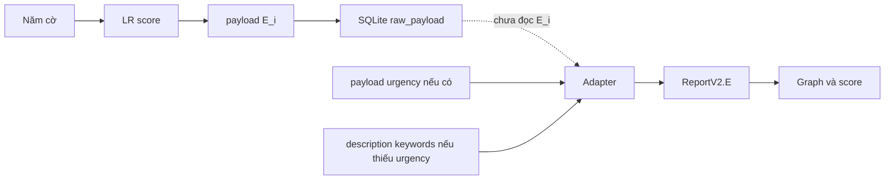

# Luồng hiện hành computed → sent → stored → consumed

Xác minh trực tiếp source tại HEAD/dirty baseline trong `../run-baseline/`; hash riêng trong input-hashes. Đây là kiểm chứng tĩnh theo mã, chưa chạy E2E.

| Mũi tên | Locator và hành vi | Mức bằng chứng |
|---|---|---|
| severeSigns → E_LR | `urgency_logistic_model.dart:score`; app_controller.dart:submitPost nạp JSON và gọi score(severeSigns); thiếu model có thể null | Implemented |
| E_LR → record → payload.E_i | app_controller.dart:submitPost; rescue_record_payload.dart:rescueRecordPayload đưa urgencyScore vào E_i | Implemented, không bảo đảm mọi lần truyền thành công |
| payload → HTTP/sync → SQLite raw_payload | rescue_repository_impl.dart; backend storage.py:save_report dùng json.dumps(meta); _row_to_dict trả payload | Implemented. Đồng bộ thành công là điều kiện để lưu backend |
| raw_payload → ReportV2.E | cluster_service.py:to_report_v2 đọc urgency nếu key hiện diện, kể cả giá trị invalid thành None; chỉ thiếu key mới fallback _urgency_from_text(description) | Implemented; không đọc E_i hoặc urgency_features |
| ReportV2.E → graph/score | compute_clusters gọi run_graph_clustering và score_clusters; rescue_core/clustering.py, priority.py | Consumed là E từ adapter, không phải E_LR theo đường app hiện hành |
| aiTags → F | top confidence tag; payload.flood ưu tiên nếu key hiện diện; label mapping non_flood=0, low=.33, medium=.66, high=1 | Implemented, không học fusion |
| L/T/N/V → tuple | lat/lng; createdAt hoặc receipt; n_trapped hoặc trapped+injured; vulnerability hoặc số cờ | Ánh xạ heuristic; ngữ nghĩa cần xác nhận chuyên môn |

Thiết kế dự kiến là thống nhất ngữ nghĩa E_LR/E của lõi và xác minh propagation bằng test trước tích hợp. P01 chỉ sửa mô tả, không nối trường hay đổi rank. Lược đồ CDM/LDM/PDM đầy đủ vẫn là thiết kế đề xuất.
